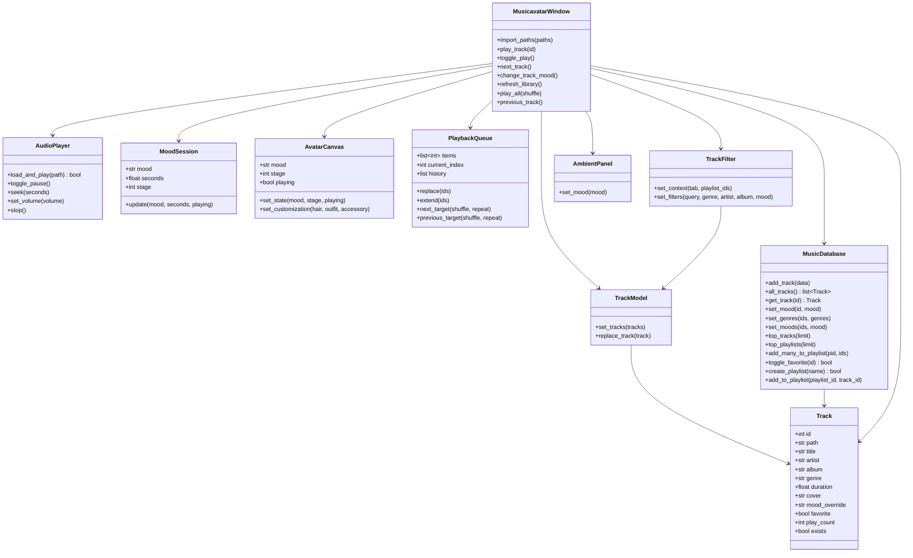

# Propuesta UML — Musicavatar

Este diagrama refleja la implementación de esta entrega. Si el equipo tiene un diagrama de clases de Unidad 4 anterior, **debe reconciliar los dos** y registrar ajustes en la matriz de trazabilidad.

**Funciones asociadas:** `metadata.read_track(path,covers_dir)` extrae etiquetas; `moods.mood_from_genre(genre)` clasifica el género y `moods.get_track_mood(track)` aplica una modificación manual si existe; `utils.format_time(seconds)` formatea el tiempo y `genres.normalize_genres()` admite varias etiquetas de género.

### Ampliación del avatar en v0.5

- `AvatarLook` (en `musicavatar/avatar_parts.py`): modelo inmutable con atributos `hair`, `outfit`, `accessory`, `hair_style`, `top_style`, `pants`, `shoes`, `skin`, `presentation`. El método `validated()` protege contra configuraciones desconocidas y conserva valores legados.
- `draw_character(painter, x, y, look, mood, playing, tick, glow)` (en `musicavatar/avatar_parts.py`): dibuja las capas individuales de personaje, rostro, ropa y accesorios con píxeles.
- `AvatarCanvas` (en `musicavatar/avatar.py`): representa `AvatarLook` en el mundo del avatar, soporta `preview=True` sin animación constante y expone `set_customization()`.
- `MusicavatarWindow` (en `musicavatar/ui.py`): crea los controles del panel, observa cambios, actualiza las dos vistas y persiste los campos en `MusicDatabase.settings`.

Relación: `MusicavatarWindow` configura `AvatarLook` mediante `AvatarCanvas`; `AvatarCanvas` delega a `draw_character`. El diseño es extensible y no afecta `AudioPlayer`.
