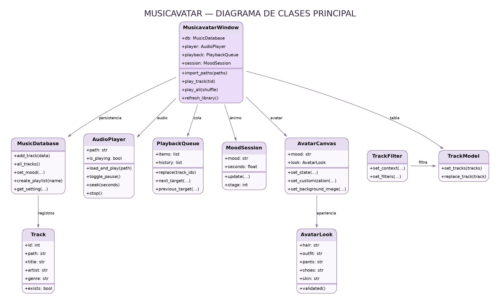
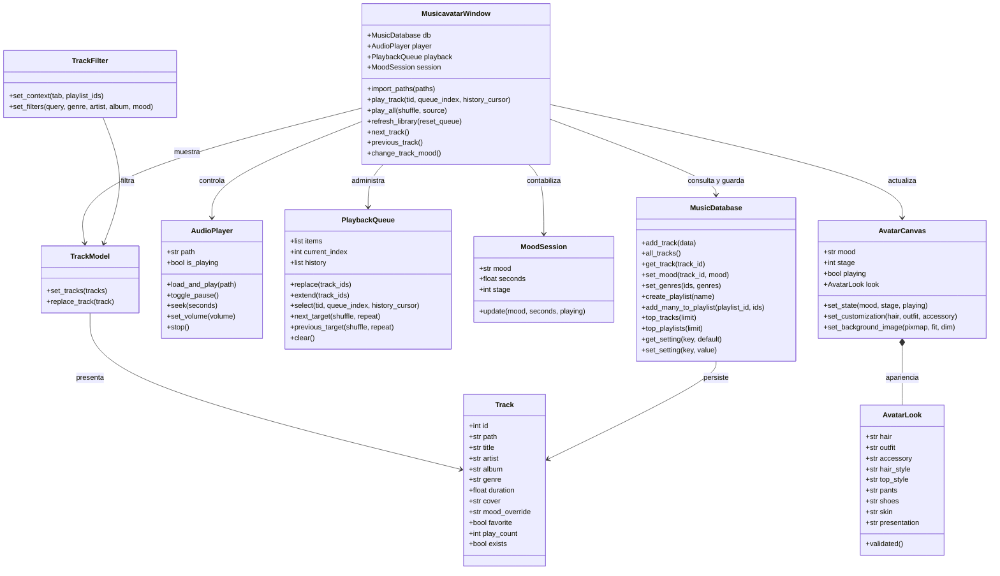
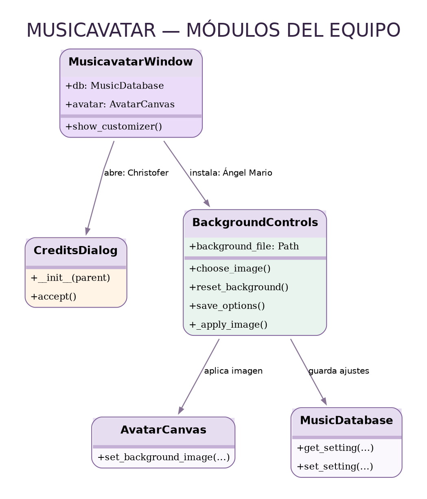
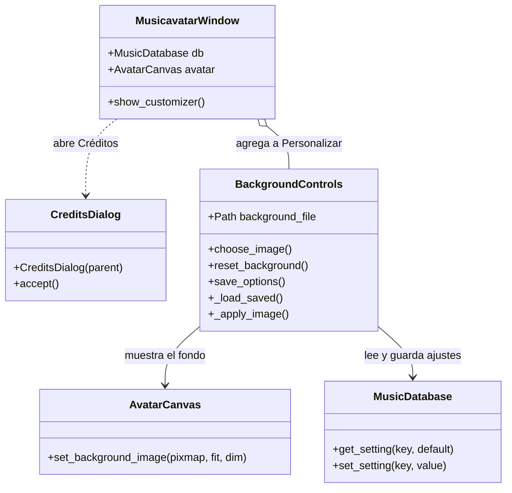

# Musicavatar — Diagrama de clases UML (implementación actual)

**Alcance:** código fuente de Musicavatar v0.5 y módulos de colaboración preparados para su integración.  
**Responsables:** Rafael Gabriel Jiménez Espinosa (núcleo), Christofer Alberto Rodríguez Ocaña (créditos) y Ángel Mario Presenda Alpuche (fondos personalizados).

> Este diagrama se obtuvo del **código implementado**. Es apto para documentar la Unidad 5, pero **no sustituye automáticamente** al diagrama que el docente pidió recuperar de la Unidad 4. Si ese documento anterior existe, contrastar sus clases y registrar ajustes en `MATRIZ_TRAZABILIDAD.md`.

## 1. Diagrama principal: reproductor y avatar

**Otros componentes usados por la ventana:** `AmbientPanel` (`backdrop.py`, fondo ambiental), `SpectrumWidget` (`spectrum.py`, visualizador), `PlaylistCard` (`playlist_cards.py`, tarjetas) y `TrackMetadataDialog` (`dialogs.py`, edición de etiquetas). No se dibujan todos para mantener legible la relación principal de las clases.

## 2. Diagrama de los paquetes del equipo

**Funciones complementarias (no son clases UML):**

- `musicavatar/team_bridge.py` → `install_team_modules(window)`: detecta e instala los módulos opcionales.
- `musicavatar/contrib/credits.py` → `install(window)`: agrega el botón **Créditos** y abre `CreditsDialog`.
- `musicavatar/contrib/credits_info.py`: constantes del proyecto y `members_text()`.
- `musicavatar/contrib/avatar_backgrounds.py` → `install(window)`: incorpora `BackgroundControls` en Personalizar.
- `musicavatar/contrib/background_rules.py` → `validate_image_path()`, `normalize_fit()`, `clamp_dim()` y `stored_background_path()`.
- `musicavatar/metadata.py` → `read_track()` y `scan_paths()`; `musicavatar/moods.py` → `get_track_mood()` y `mood_from_genre()`.

## 3. Descripción breve de las relaciones

- `MusicavatarWindow` coordina la biblioteca, la cola, el audio y los estados del avatar; **no** almacena los archivos musicales dentro de la base de datos.
- `MusicDatabase` almacena rutas, metadatos y preferencias; reconstruye instancias `Track` al consultar.
- `AvatarCanvas` usa un objeto `AvatarLook` para dibujar el personaje por capas.
- `CreditsDialog` es un diálogo opcional, cargado por el puente de integración.
- `BackgroundControls` cambia **únicamente el escenario del avatar**, lee ajustes en `MusicDatabase` y transmite una imagen a `AvatarCanvas`.

## 4. Correspondencia con archivos

| Clase | Archivo de implementación | Responsable |
|---|---|---|
| `Track`, `MusicDatabase`, `AudioPlayer`, `PlaybackQueue`, `MoodSession`, `AvatarLook`, `AvatarCanvas`, `TrackModel`, `TrackFilter`, `MusicavatarWindow` | `musicavatar/models.py`, `database.py`, `player.py`, `queue_logic.py`, `moods.py`, `avatar_parts.py`, `avatar.py`, `track_table.py`, `ui.py` | Rafael |
| `CreditsDialog` | `musicavatar/contrib/credits.py` | Christofer |
| `BackgroundControls` | `musicavatar/contrib/avatar_backgrounds.py` | Ángel Mario |

**Estado actual:** las clases principales están en v0.5. Las clases de Créditos y Fondos están en los módulos preparados por el equipo; confirmar que sus Pull Requests están fusionados antes de marcar su integración como terminada.
